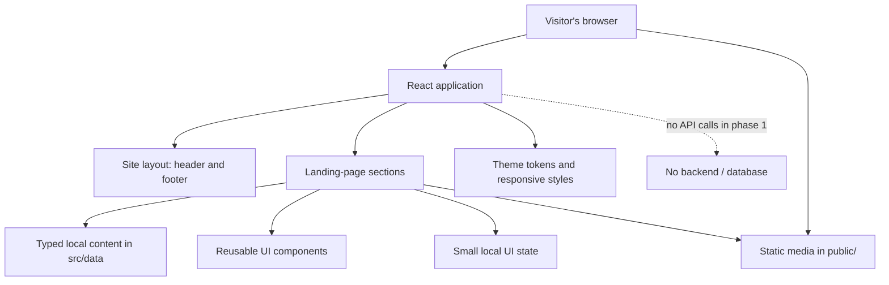

# Frontend Architecture

## 1. Architecture Principles

The first release is a **frontend-only prototype**. Prefer a simple, component-based architecture that is easy to present, review, and extend after the client approves the design.

- Render pages and sections with React components.
- Use TypeScript types for content and component props.
- Keep repeatable page content in local data files rather than embedding it in JSX.
- Serve approved media from the Vite `public/` directory.
- Keep user interactions local to the browser unless an external link is explicitly opened.
- Do not add a backend abstraction or API layer before there is a defined backend requirement.

## 2. High-Level Structure



## 3. Component Composition

Recommended composition:

```text
App
└── HomePage
    ├── SiteHeader
    ├── HeroSection
    ├── AccommodationSection
    │   └── AccommodationCard (repeatable)
    ├── GallerySection
    │   └── GalleryItem (repeatable)
    ├── AboutSection
    ├── LocationSection
    ├── ContactSection
    └── SiteFooter
```

Keep `SiteHeader`, `SiteFooter`, cards, buttons, and media elements reusable. Sections should primarily compose components and display content. Avoid creating an elaborate design-system package for a single-page demo.

## 4. Content and State

### Static content

Store room/service cards, gallery items, navigation labels, social links, and business content in `src/data/siteContent.ts` or focused files under `src/data/`.

Define TypeScript types for repeatable entries, for example:

```ts
export type AccommodationItem = {
  id: string;
  name: string;
  shortDescription: string;
  image: string;
  imageAlt: string;
  amenities?: string[];
};
```

Only include optional fields when the client has supplied or approved the data. Prices, capacities, and availability should not be added as fake values.

### Local UI state

Use React state only where interaction requires it, such as:

- Mobile menu open/closed state.
- Current gallery image or lightbox state.
- Enquiry form validation and demo confirmation state, if that form is approved.

Do not store user information in local storage or send it to a server in this phase. Refreshing the page may reset demo-only interaction state.

## 5. Asset Architecture

Place supplied media in the following convention:

```text
public/
├── images/
│   ├── branding/
│   ├── hero/
│   ├── rooms/
│   ├── gallery/
│   └── location/
└── videos/
    ├── hero/
    └── gallery/
```

Files inside Vite's `public/` directory are served from the site root. For example:

- File: `public/images/hero/da-lat-stay.webp`
- URL in the app: `/images/hero/da-lat-stay.webp`

Do **not** use `/public/images/...` in browser URLs. Use descriptive, lowercase, hyphen-separated filenames. Prefer optimized WebP/AVIF images where supported and retain a sensible source copy outside the deploy output if required by the team.

For videos, provide a poster image, use native `<video>` controls where appropriate, and avoid autoplay with sound. Lazy-load below-the-fold media when practical. Never rely on Google Drive preview URLs as production media paths; copy approved files into `public/`.

## 6. Navigation and External Actions

- Use in-page anchors for the main landing-page sections.
- Use `tel:` for a verified phone number.
- Use the client-approved Zalo or Facebook destination for contact.
- Open the verified Google Maps destination in a new tab when appropriate, with safe link attributes.
- Do not present a CTA as functional when its destination has not been supplied. Either use a clear placeholder during development or hide it until confirmed.

## 7. Enquiry Form, If Included

A demo form can have a small frontend-only flow:

1. User enters the required fields.
2. The browser validates required values and formats.
3. Invalid fields display an understandable message.
4. A valid submission shows a message such as **“Demo only — no enquiry has been sent.”**
5. Form values are not transmitted or persisted.

A future production form requires a separate decision about the backend endpoint, validation, privacy notice, data retention, spam protection, and success/error handling.

## 8. Error and Empty States

- If a local media file is missing, provide a fallback visual or hide the media slot gracefully.
- If client content is not confirmed, do not fabricate details. Use a tracked placeholder in development or omit the section from the client-facing build.
- External links may be unavailable; make destinations explicit and test them during review.
- Keep browser-console warnings and errors clear during the demo.

## 9. Future Extension Points

After approval, the architecture can be extended with routing, a CMS/API, server-backed enquiries, multilingual content, or a booking service. Add these only when requirements and ownership are agreed. Do not simulate production booking functionality with static data in a way that could mislead a visitor.
