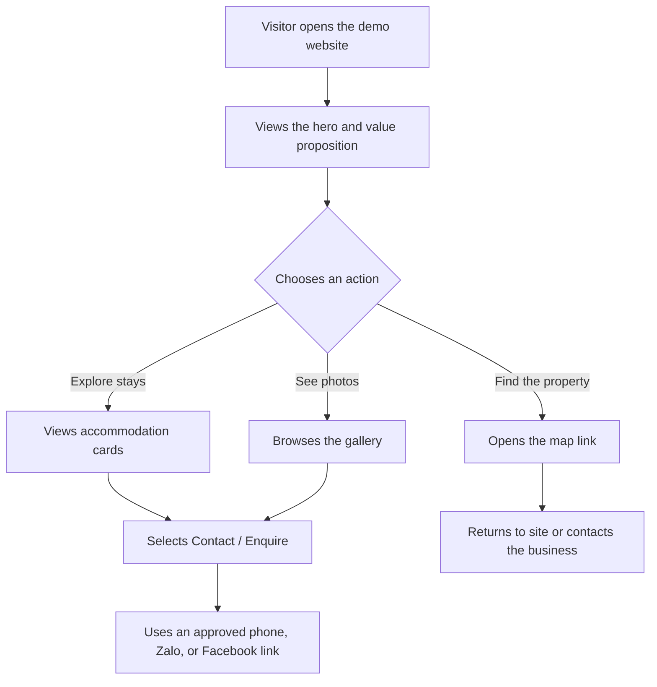

# Project Overview — Ngu Am Da Lat

## 1. Project Summary

**Project:** Ngủ Ấm Ở Đà Lạt  
**Business category:** Tourism and accommodation  
**Website type:** Brand and service showcase website  
**Phase:** Client-facing frontend demo  
**Primary language:** Vietnamese

The website introduces Ngủ Ấm Ở Đà Lạt, presents its accommodation services, shows approved property photos and videos, and guides potential guests toward a contact or enquiry action. The initial deliverable is a polished, responsive frontend prototype. It is not a production booking system.

## 2. Business Goals

1. Establish a clear online presence for the accommodation business.
2. Present available room or stay options in a visually appealing, easy-to-scan format.
3. Communicate the brand's warm, comfortable, Da Lat-inspired positioning.
4. Help visitors contact the business through approved channels.
5. Collect client feedback on the website structure, visual direction, and content before any backend work begins.

## 3. Target Audience

- Domestic travellers planning a stay in Da Lat.
- International travellers looking for accommodation in Da Lat.
- Visitors comparing room options, property imagery, location, and contact details.

The brief specifies Vietnamese as the website language. Keep the content structure easy to internationalize later, but do not build a language switcher in this demo unless the client requests it.

## 4. Brand Direction

Use the following visual direction from the client brief:

- **Primary:** warm earth brown or terracotta.
- **Background:** light beige.
- **Accent:** pine green.
- **Mood:** warm, calm, comfortable, nature-oriented, and appropriate for Da Lat.

Use real client-approved branding and media whenever available. Do not invent room prices, room capacity, amenities, guest reviews, awards, or claims about the property. Mark any missing content as a placeholder in the implementation and replace it before the client presentation.

## 5. Proposed Demo Experience

A single-page landing site is the default scope because the brief asks for a business/service introduction and does not define a multi-page information architecture.

Recommended page sections:

1. **Header and navigation** — logo and anchor links to the main sections.
2. **Hero** — concise value proposition, property image/video if approved, and primary contact CTA.
3. **Accommodation overview** — three to five room or service cards, using verified content only.
4. **Gallery** — approved photos and optional video; support opening a larger image if needed.
5. **About the stay** — short introduction and differentiators confirmed by the client.
6. **Da Lat / location section** — approved location information and a link to Google Maps.
7. **Contact CTA** — phone/Zalo and Facebook links after verification.
8. **Footer** — business name, navigation, and contact links.

This is a proposed structure, not a claim that all room details or copy have already been supplied.

## 6. Primary User Flow

If an enquiry form is included in the demo, it must be clearly treated as a frontend-only interaction. Validate fields in the browser and show a demo confirmation state, but do not imply that an enquiry was sent to the business or store it remotely.

## 7. Scope

### Included in Phase 1

- Responsive frontend implementation.
- Landing-page sections and navigation.
- Local static content and mock data.
- Client-provided images, logo, and videos stored under `public/`.
- Frontend-only interactions such as gallery preview, mobile navigation, and demo form validation where approved.
- Links to verified external contact and map destinations.
- Preview deployment for client review.

### Explicitly Out of Scope

- Backend, database, or content management system.
- Real booking availability, reservation management, or room inventory.
- Payment processing, accounts, authentication, or customer profiles.
- Real email/CRM delivery for enquiry forms.
- Admin dashboard, analytics integrations, and production SEO/content operations beyond demo-level metadata.
- Unapproved pricing, room descriptions, customer testimonials, or property claims.

## 8. Acceptance Criteria

- The page renders correctly on mobile, tablet, and desktop breakpoints.
- The primary navigation and every visible CTA have a defined, working destination or interaction.
- Images and videos load from local paths under `public/`; no essential demo content depends on temporary third-party image URLs.
- Media has appropriate alternative text, and videos do not autoplay with sound.
- The chosen brand palette is used consistently and text remains readable against its background.
- The demo does not claim that a booking or enquiry has been transmitted or confirmed.
- Missing client content is clearly tracked and resolved or visibly marked before the final demo.
- The project builds successfully and has no blocking console errors during the main user flow.

## 9. Open Questions Before Client Approval

The source brief does not yet confirm the following. Track them as content decisions rather than inventing answers:

- Final room/service names, room count, capacities, amenities, prices, and availability wording.
- Approved description of the property and its unique selling points beyond its location in Da Lat.
- Exact phone/Zalo formatting and which contact channel should be the primary CTA.
- Which photos/videos are approved for public display and whether people appearing in them have granted permission.
- Whether an enquiry form, embedded map, English content, or separate room-detail pages are required.
- Final reference websites, delivery deadline, demo approval status, and client feedback process.

## 10. Source Materials

- **Logo and media folder supplied in the brief:** <https://drive.google.com/drive/folders/17VTTdCJvSjI3dbHLsafRw2Rrh8PxYsrh>
- **Facebook page supplied in the brief:** <https://www.facebook.com/profile.php?id=61559001633103>
- **Google Maps search supplied in the brief:** <https://www.google.com/maps/search/+l,+%C4%90%C3%A0+L%E1%BA%A1t,+Vietnam,+66106/@11.928106,108.3977835,17070m/data=!3m2!1e3!4b1?entry=ttu>

Confirm that the assets and contact destinations are current before the client demo. Do not treat the source folder as proof that every file inside it is approved for publication.
